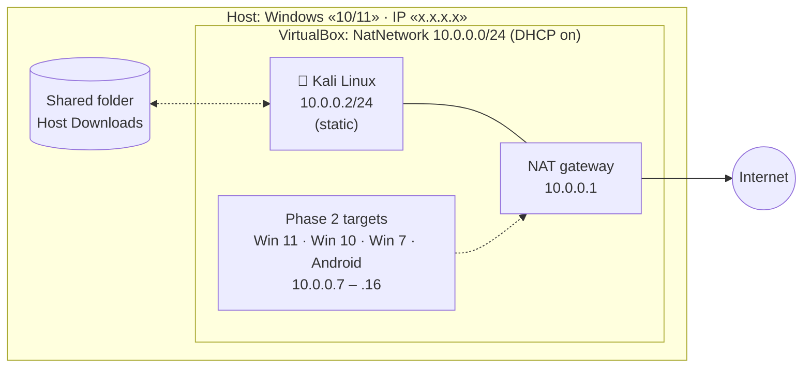
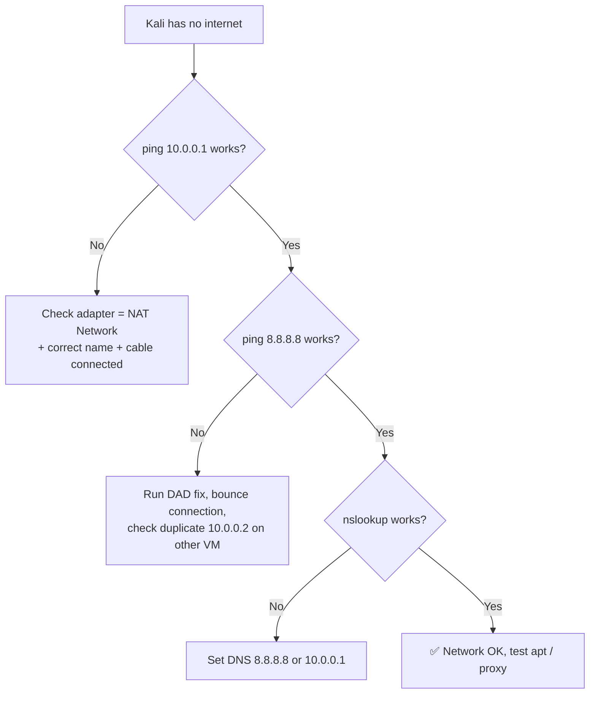

<div align="center">

# 🛡️ Isolated Cybersecurity Lab: VirtualBox + Kali Linux on a Private NAT Network

**Networkwalks Academy · Week 1 · Project Module 1 (WK1-PM1)**


*A reproducible, snapshot-protected attacker machine that cannot touch my real network.*

</div>

---

## 📑 Contents
1. [Summary](#-summary)
2. [Requirements checklist](#-requirements-checklist-wk1-pm1)
3. [Architecture](#-architecture)
4. [My hardware & software](#-my-hardware--software)
5. [Why NAT Network](#-design-decision-why-nat-network)
6. [Build procedure](#-build-procedure)
7. [Verification evidence](#-verification-evidence)
8. [Problems I hit & how I solved them](#-problems-i-hit--how-i-solved-them)
9. [Lab hygiene & safety](#-lab-hygiene--safety)
10. [Troubleshooting guide](#-troubleshooting-guide)
11. [What I learned](#-what-i-learned)
12. [Roadmap (Phase 2)](#-roadmap-phase-2)
13. [Author](#-author)

---

## 🎯 Summary

I built an isolated offensive-security lab on my own «LAPTOP MODEL». The lab has a Kali Linux attacker VM on a custom VirtualBox **NAT Network (`10.0.0.0/24`)** with a **static IP of `10.0.0.2`**, full internet access, clipboard/drag-and-drop, a shared host folder, and a clean **baseline snapshot**.

The goal is not just "Kali runs". The goal is a lab where I can break things, scan things, and recover in seconds, with no risk to my host or home network, and where other VMs (Windows targets, CTF machines) can be dropped in later.

---

## ✅ Requirements checklist (WK1-PM1)

| # | Requirement | Status | Evidence |
|---|---|:--:|---|
| 1 | VirtualBox as base (latest recommended) | ✅ | [Screenshot 01](#evidence-gallery) · version `«x.y.z»` |
| 2 | Kali Linux as attacker machine | ✅ | [Screenshot 03](#evidence-gallery) |
| 3 | Network in subnet `10.0.0.0/24` | ✅ | [Screenshot 02](#evidence-gallery) |
| 4 | Uses a **NATNetwork** with `10.0.0.0/24` | ✅ | [Screenshot 02](#evidence-gallery) |
| 5 | Clipboard & drag/drop enabled | ✅ | [Screenshot 05](#evidence-gallery) |
| 6 | Shared folder: host `/Downloads` | ✅ | [Screenshot 06](#evidence-gallery) |
| 7 | Kali IP = `10.0.0.2/24` | ✅ | [Screenshot 04](#evidence-gallery) · `ip a` output below |
| 8 | Kali has full internet access | ✅ | ping/DNS/`apt` output below |
| 9 | Snapshot taken | ✅ | [Screenshot 07](#evidence-gallery) |

---

## 🏗️ Architecture



**Traffic rules of this design**

| Direction | Allowed? | Why |
|---|:--:|---|
| Kali → Internet | ✅ | Updates, tool installs, research |
| Kali ↔ other VMs on NatNetwork | ✅ | Attack/defence practice |
| Internet → Kali (unsolicited) | ❌ | NAT Network blocks inbound unless I add port forwarding |
| Other devices on my home LAN → Kali | ❌ | VMs sit behind the NAT, invisible to the LAN |

---

## 💻 My hardware & software

| Component | Value |
|---|---|
| Laptop | «brand / model» |
| CPU | «Intel Core i5-6300U, 4 cores» |
| RAM (host) | «8 GB» |
| Storage | «465 GB HDD, 255 GB free before setup» |
| Host OS | «Windows 10/11, build xxxxx» |
| VirtualBox | «Kali-linux» |
| Kali image | `kali-linux-«2026.x»-virtualbox-amd64` |
| Kali VM resources | «3 GB RAM · 2 vCPU · 100 GB disk» |
| Host IP (LAN) | «x.x.x.x» |

> 📌 Minimum recommended by the course: 8 GB RAM, 256 GB SSD, Core i3/i5.

---

## 🧠 Design decision: why NAT Network?

VirtualBox offers several adapter modes. I chose **NAT Network** deliberately:

| Mode | VM ↔ VM | VM → Internet | LAN/host can reach VM | Fit for this lab |
|---|:--:|:--:|:--:|---|
| NAT | ❌ (each VM isolated) | ✅ | ❌ | ❌ VMs can't attack each other |
| **NAT Network** | ✅ | ✅ | ❌ | ✅ **Chosen** |
| Bridged | ✅ | ✅ | ✅ | ⚠️ Puts vulnerable VMs on my real home network |
| Host-only | ✅ | ❌ | host only | ⚠️ No internet for Kali updates |
| Internal | ✅ | ❌ | ❌ | ⚠️ No internet, no gateway |

NAT Network is the only mode that gives **VM-to-VM traffic + internet + isolation from my home LAN** at the same time, which is exactly what a safe attack/defence lab needs.

---

## 🪜 Build procedure

### Step 1 · Prepare the host
- Installed **7-Zip** (the Kali VM image ships as a `.7z`).
- Confirmed hardware virtualization is on (Task Manager → Performance → CPU → *Virtualization: Enabled*). «Note anything you had to change.»
- Verified the integrity of downloads: `«sha256 check you performed, if any»`.

### Step 2 · Install VirtualBox
Installed the latest version from the official site. «Mention Extension Pack if installed.»

### Step 3 · Create the NAT Network
`File → Tools → Network → NAT Networks → Create`

| Field | Value |
|---|---|
| Name | `NatNetwork` |
| IPv4 Prefix | `10.0.0.0/24` |
| Enable DHCP | ✅ |
| Enable IPv6 | ❌ (not needed, smaller attack surface) |

### Step 4 · Import Kali
Downloaded the pre-built VirtualBox image from the official Kali site, extracted it, and imported/added it in VirtualBox.

VM settings applied:

| Setting | Value |
|---|---|
| Adapter 1 | Attached to **NAT Network** → `NatNetwork` |
| Adapter type | Intel PRO/1000 MT Desktop (82540EM) |
| Promiscuous mode | Allow All *(required later for sniffing/ARP work)* |
| Base memory | «x MB» |
| Processors | «x» |
| Shared Clipboard | **Bidirectional** |
| Drag'n'Drop | **Bidirectional** |
| Shared folder | Host `«C:\Users\<you>\Downloads»` → auto-mount ✅, full access |

### Step 5 · Static IP on Kali
Set through NetworkManager (`Edit Connections → Wired connection 1 → IPv4 Settings`):

| Field | Value |
|---|---|
| Method | Manual |
| Address / Netmask | `10.0.0.2` / `24` |
| Gateway | `10.0.0.1` |
| DNS | `8.8.8.8` *(fallback: `10.0.0.1`)* |

CLI equivalent (so it is scriptable and reproducible):

```bash
sudo nmcli connection modify "Wired connection 1" \
  ipv4.method manual \
  ipv4.addresses 10.0.0.2/24 \
  ipv4.gateway 10.0.0.1 \
  ipv4.dns "8.8.8.8" \
  ipv4.dad-timeout 0
sudo nmcli connection down "Wired connection 1"
sudo nmcli connection up   "Wired connection 1"
```

### Step 6 · Guest integration check
```bash
# Shared folder
ls /media/sf_Downloads        # «adjust to your actual mount path»
# User must be in vboxsf group for access
groups | grep vboxsf
```

### Step 7 · Snapshot
`Machine → Take Snapshot` → name: `«Kali-clean-baseline_10.0.0.2_YYYY-MM-DD»`
Description: *"Fresh Kali, static IP, internet verified, shared folder and clipboard working."*

---

## 🔬 Verification evidence

I verified every claim with a command, not by assumption.

| Test | Command | Result |
|---|---|---|
| Static IP applied | `ip -br a` | «paste output» |
| Default route | `ip route` | «default via 10.0.0.1» |
| Gateway reachable | `ping -c 4 10.0.0.1` | «x/4 replies» |
| Internet (IP) | `ping -c 4 8.8.8.8` | «x/4 replies» |
| DNS resolution | `nslookup networkwalks.com` | «resolved to …» |
| Package manager works | `sudo apt update` | «OK» |
| Shared folder | `touch /media/sf_Downloads/test.txt` → seen on host | «yes/no» |
| Clipboard | Copy host → paste Kali and reverse | «yes/no» |
| Snapshot restore | Changed hostname → restored snapshot → hostname reverted | «yes/no» |

**One-shot verification script** (I wrote this so the whole lab can be re-checked in seconds):

```bash
#!/usr/bin/env bash
# lab-verify.sh: quick health check for the WK1-PM1 Kali lab
pass(){ echo -e "[\e[32mPASS\e[0m] $1"; }
fail(){ echo -e "[\e[31mFAIL\e[0m] $1"; }

ip -4 addr show | grep -q "10.0.0.2/24"         && pass "Static IP 10.0.0.2/24 present"   || fail "IP not 10.0.0.2/24"
ip route | grep -q "default via 10.0.0.1"       && pass "Default gateway 10.0.0.1"        || fail "Gateway wrong"
ping -c2 -W2 10.0.0.1 >/dev/null 2>&1           && pass "Gateway reachable"               || fail "Gateway unreachable"
ping -c2 -W2 8.8.8.8  >/dev/null 2>&1           && pass "Internet reachable (IP)"         || fail "No internet by IP"
getent hosts networkwalks.com >/dev/null 2>&1   && pass "DNS resolves"                    || fail "DNS failing"
ls /media/sf_* >/dev/null 2>&1                  && pass "Shared folder mounted"           || fail "Shared folder missing"
```

### Evidence gallery

| # | What it proves | File |
|---|---|---|
| 01 | VirtualBox version + VM list | `screenshots/01-virtualbox-manager.png` |
| 02 | NAT Network `10.0.0.0/24`, DHCP on | `screenshots/02-natnetwork.png` |
| 03 | Kali running | `screenshots/03-kali-desktop.png` |
| 04 | Kali IPv4 manual settings + `ip a` | `screenshots/04-kali-ip.png` |
| 05 | Clipboard & drag/drop = Bidirectional | `screenshots/05-clipboard-dnd.png` |
| 06 | Shared folder (host Downloads) | `screenshots/06-shared-folder.png` |
| 07 | Snapshot tree | `screenshots/07-snapshot.png` |
| 08 | Ping/DNS/apt output | `screenshots/08-connectivity.png` |

> ⚠️ Blur or crop anything sensitive (username in paths, serials, public IP).

---

## 🐞 Problems I hit & how I solved them

> **Only keep problems you personally faced. Use this exact format for each.**

### Problem 1: «short title»
- **Symptom:** «exact error / behaviour»
- **Diagnosis:** «what you checked and what it told you»
- **Root cause:** «why it happened»
- **Fix:** «commands / settings»
- **Proof it worked:** «output / screenshot»

*Example of the level of depth to aim for (replace with your real issue):*

### Problem: Kali had a static IP but no internet
- **Symptom:** `ping 10.0.0.1` worked but `ping 8.8.8.8` hung; browser couldn't load pages.
- **Diagnosis:** Checked `ip route` (gateway present), then tested IP vs hostname ping to split routing from DNS. «your actual findings»
- **Root cause:** Known issue with newer VirtualBox 7 + Kali 2026.x: NetworkManager's **Duplicate Address Detection (DAD)** delays bringing up a static IPv4 address, so the connection looks up but isn't usable. Setting the DAD timeout to 0 skips that wait.
- **Fix:**
  ```bash
  sudo nmcli connection modify "Wired connection 1" ipv4.dad-timeout 0
  sudo nmcli connection down "Wired connection 1"
  sudo nmcli connection up   "Wired connection 1"
  ```
- **Proof:** `ping 8.8.8.8` and `sudo apt update` succeeded.

### Problem: «another real one: VT-x disabled, shared folder permission denied, DNS, duplicate IP, etc.»
«Same five fields.»

---

## 🔐 Lab hygiene & safety

- **Isolation:** NAT Network keeps lab VMs off my home LAN; inbound access is blocked unless I add a port-forward rule.
- **Snapshot-first workflow:** snapshot before every new tool/exploit experiment; restore after.
- **Shared folder risk:** the host `Downloads` folder is a bridge between host and a machine I will use to handle malware samples later. I am treating it as **untrusted**: «e.g. do not run anything from it on the host; consider switching to a dedicated `lab-share` folder or read-only for malware work».
- **Clipboard/drag-drop risk:** bidirectional sharing is convenient but widens the host↔guest boundary. «Will set to Disabled or one-way when analysing malware.»
- **Authorisation:** only test systems I own or have **written permission** to test.
- **Default credentials:** «changed the default `kali` password: yes/no».

---

## 🧭 Troubleshooting guide



---

## 💡 What I learned

1. «Your own insight about NAT vs NAT Network, in your words»
2. «Your own insight about static IP, gateway, DNS: what each one actually does»
3. «Your own insight about DAD / NetworkManager»
4. «Your own insight about snapshots and recovery»
5. «Anything unexpected you learned»

---

## 🚀 Roadmap (Phase 2)

- [ ] Windows 11 / 10 / 7 target VMs on `10.0.0.0/24` (planned IPs `.11`, `.10`, `.7`)
- [ ] Android 9 VM (`10.0.0.9`)
- [ ] Optional Windows Server 2016 + Active Directory lab (`10.0.0.16`)
- [ ] Full ping matrix between all machines
- [ ] Snapshot every VM; export an appliance backup

---

## 🔗 References

- VirtualBox: <https://virtualbox.org/wiki/Downloads>
- Kali Linux: <https://kali.org/get-kali>
- 7-Zip: <https://7-zip.org/download.html>
- VirtualBox networking modes: <https://www.virtualbox.org/manual/ch06.html>

---

## 👤 Author

**Thinul Bopearachchi (BL4CK_KN1GHT)**
Cyber Security student · Networkwalks Cybersecurity Internship, Batch «XXX»
LinkedIn: «your URL» · GitHub: «your URL»

*Built and documented as part of Networkwalks Academy, Week 1 (WK1-PM1).*
