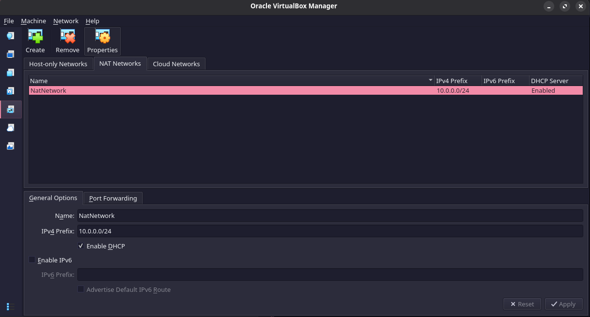
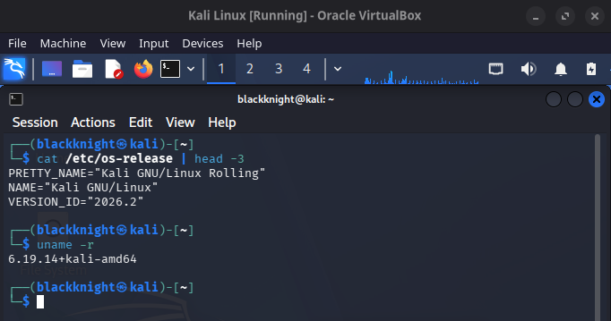
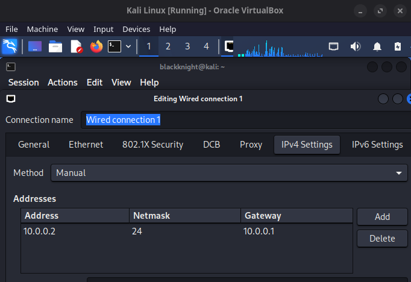
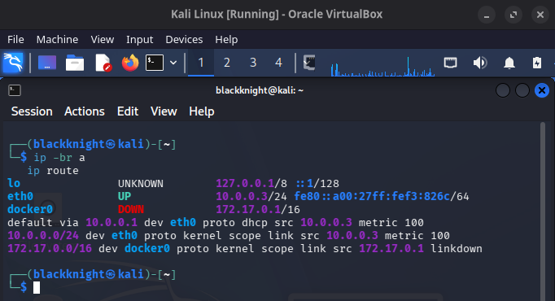
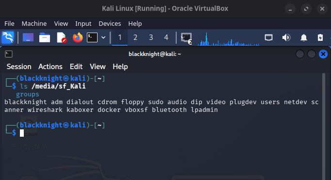
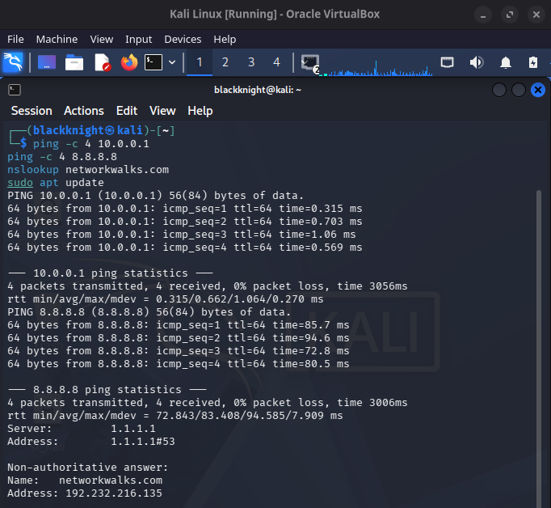
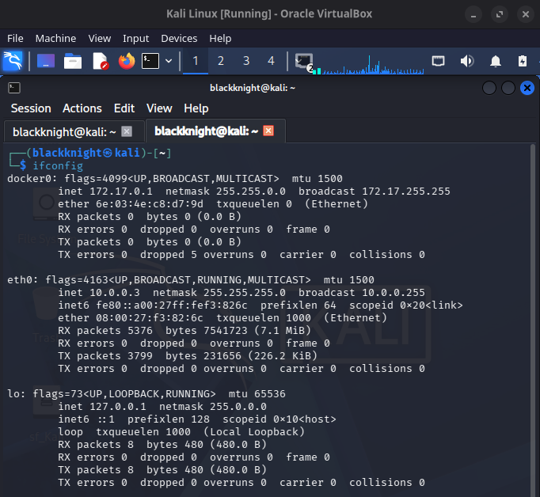
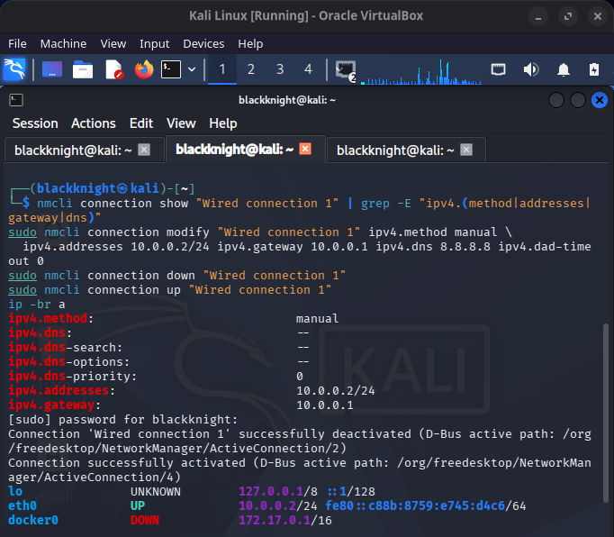

<div align="center">

# 🛡️ Cybersecurity Lab Setup: VirtualBox + Kali Linux


**An isolated attacker machine on a private virtual network, built on my own laptop.**

</div>

---

## 📌 Summary

I built a Kali Linux attacker VM on VirtualBox and attached it to a custom **NAT Network (`10.0.0.0/24`)**. The VM has internet access, a shared host folder, and sits behind NAT so it is not exposed to my real network. It is the base for the later labs (Windows targets and CTF machines on the same subnet).

Every result below is backed by a screenshot from my own machine.

---

## ✅ Requirements checklist

| # | Requirement | Status | Evidence |
|---|---|:--:|---|
| 1 | VirtualBox as base (latest) | ✅ | [01](#01--virtualbox-version) |
| 2 | Kali Linux as attacker machine | ✅ | [03](#03--kali-linux-running) |
| 3 | Subnet `10.0.0.0/24` | ✅ | [02](#02--nat-network) |
| 4 | NATNetwork with `10.0.0.0/24` | ✅ | [02](#02--nat-network) |
| 5 | Clipboard & drag/drop enabled | «add screenshot» | «Settings → General → Advanced» |
| 6 | Shared folder from host Downloads | ✅ mounted | [06](#06--shared-folder) |
| 7 | Kali IP = `10.0.0.2/24` | ✅ after fix, see [Problem 1](#-problems-i-faced) | [04](#04--static-ip-configured), [Problem 1 proof](#-problems-i-faced) |
| 8 | Full internet access | ✅ | [07](#07--connectivity-tests) |
| 9 | Snapshot taken | «add screenshot» | «Snapshots tab» |

---

## 🧰 My environment

| Item | Value |
|---|---|
| Laptop | «model, CPU, RAM, storage» |
| Host OS | «your host OS» |
| VirtualBox | **7.2.8 r173730** (Qt 6.11.1) |
| Guest OS | **Kali GNU/Linux Rolling 2026.2** |
| Guest kernel | `6.19.14+kali-amd64` |
| Guest user / host | `blackknight@kali` |
| Network | NatNetwork, `10.0.0.0/24`, DHCP enabled, IPv6 off |
| Gateway | `10.0.0.1` |
| Extra interface | `docker0` `172.17.0.1/16` (Docker installed, outside the lab subnet) |

---

## 🪜 Build steps & evidence

### 01 · VirtualBox version
Installed the latest VirtualBox from the official site. **Help → About** shows version 7.2.8.


### 02 · NAT Network
`File → Tools → Network → NAT Networks → Create`
Name `NatNetwork`, prefix `10.0.0.0/24`, DHCP **Enabled**, IPv6 off.



**Why NAT Network:** unlike plain NAT, VMs on the same NAT Network can talk to each other, and unlike Bridged they stay hidden from my home LAN. That is what a safe attacker/target lab needs.

### 03 · Kali Linux running
Imported the official Kali VirtualBox image. Confirmed with `cat /etc/os-release | head -3` and `uname -r`.



### 04 · Static IP configured
`Network Manager → Edit Connections → Wired connection 1 → IPv4 Settings`: Method **Manual**, address `10.0.0.2`, netmask `24`, gateway `10.0.0.1`.



### 05 · Live IP check (before the fix)
This check exposed the problem described in [Problem 1](#-problems-i-faced): the live address was `10.0.0.3`, not `10.0.0.2`.

```bash
ip -br a
ip route
```


### 06 · Shared folder
The shared folder mounts at `/media/sf_Kali`, and my user is in the `vboxsf` group, which is required for access.



### 07 · Connectivity tests (with the static IP `10.0.0.2`)
Run after fixing the static IP ([Problem 1](#-problems-i-faced)), to prove internet works with the manual configuration.

```bash
ping -c 4 10.0.0.1 && ping -c 4 8.8.8.8 && nslookup networkwalks.com
```

| Test | Result |
|---|---|
| Gateway `10.0.0.1` | 4/4 replies, 0% packet loss, avg 1.58 ms |
| Internet `8.8.8.8` | 4/4 replies, 0% packet loss, avg 86.58 ms |
| DNS `networkwalks.com` | Resolved to `192.232.216.135`, answered by my configured DNS server `8.8.8.8` |

The DNS answer coming from `8.8.8.8` (earlier it came from `1.1.1.1` via DHCP) confirms the manual DNS setting is active.



### 08 · Interface details


---

## 🐞 Problems I faced

### Problem 1: Kali kept a DHCP address (`10.0.0.3`) instead of the required static `10.0.0.2`

| | |
|---|---|
| **Symptom** | I had set IPv4 to Manual `10.0.0.2/24` in the Network Manager GUI, but `ip -br a` showed `eth0` as **`10.0.0.3/24`** and `ip route` showed `proto dhcp`. |
| **Evidence (before)** | Screenshots [04](#04--static-ip-configured), [05](#05--live-ip-check-before-the-fix) and [08](#08--interface-details) |
| **Diagnosis** | `nmcli connection show "Wired connection 1"` reported `ipv4.method: manual` and `ipv4.addresses: 10.0.0.2/24`, so the saved profile was correct. The live interface was still running on the old DHCP lease, meaning the saved settings had not been applied to the active connection. `ipv4.dns` was also empty. |
| **Fix** | Re-applied the settings from the CLI (adding DNS `8.8.8.8` and `ipv4.dad-timeout 0`, the course-recommended fix for VirtualBox 7 / newer Kali), then restarted the connection so the profile became active. |
| **Result** | `eth0` is now **`10.0.0.2/24`**. |

```bash
sudo nmcli connection modify "Wired connection 1" \
  ipv4.method manual \
  ipv4.addresses 10.0.0.2/24 \
  ipv4.gateway 10.0.0.1 \
  ipv4.dns 8.8.8.8 \
  ipv4.dad-timeout 0
sudo nmcli connection down "Wired connection 1"
sudo nmcli connection up "Wired connection 1"
ip -br a
```

**Output after the fix:**

```text
Connection 'Wired connection 1' successfully deactivated
Connection successfully activated
lo               UNKNOWN        127.0.0.1/8 ::1/128
eth0             UP             10.0.0.2/24 fe80::c88b:8759:e745:d4c6/64
docker0          DOWN           172.17.0.1/16
```



**Takeaway:** saving a setting in the GUI does not prove it is live. Always verify the running state with `ip -br a` and `ip route`, and look for `proto dhcp` vs `proto static`.

---

## 🔐 Safety notes

- The VM is behind NAT, so my home LAN cannot reach it and inbound traffic is blocked by default.
- The host folder is shared with the VM, so I treat its contents as untrusted.
- I only test systems I own or have written permission to test.

---

## 💡 What I learned

- «your own sentence about NAT vs NAT Network»
- «your own sentence about how you spotted DHCP vs static»
- «your own sentence about verifying with commands instead of assuming»

---

## 🚀 Next steps

- Add Windows target VMs on `10.0.0.0/24` and ping-test between machines
- Snapshot every VM as a clean baseline

---

## 👤 Author

**Thinul Bopearachchi (BL4CK_KN1GHT)**
Cyber Security student · Networkwalks Cybersecurity Internship
LinkedIn: «your URL» · GitHub: «your URL»
